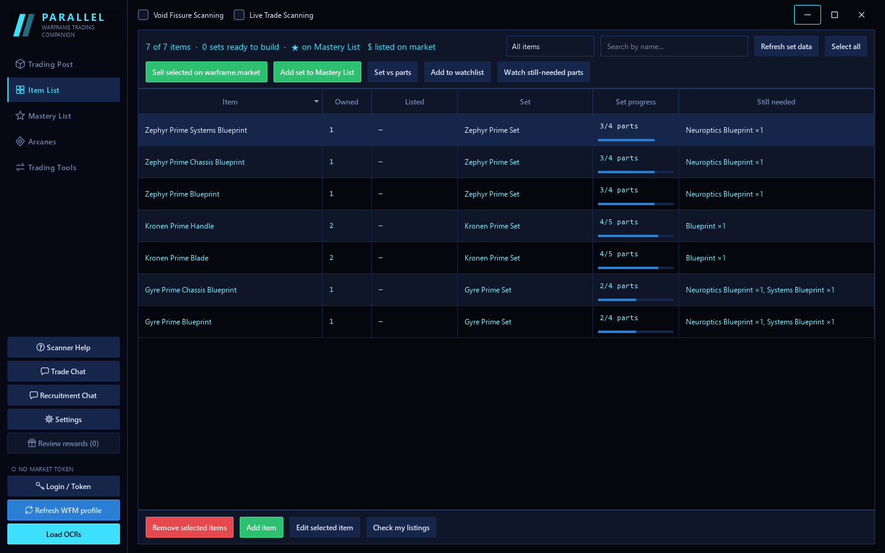
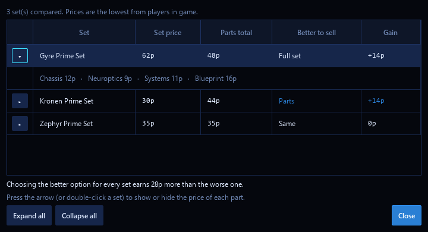
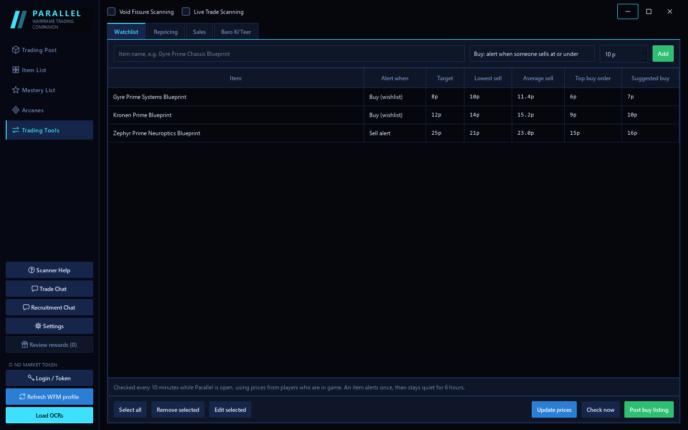
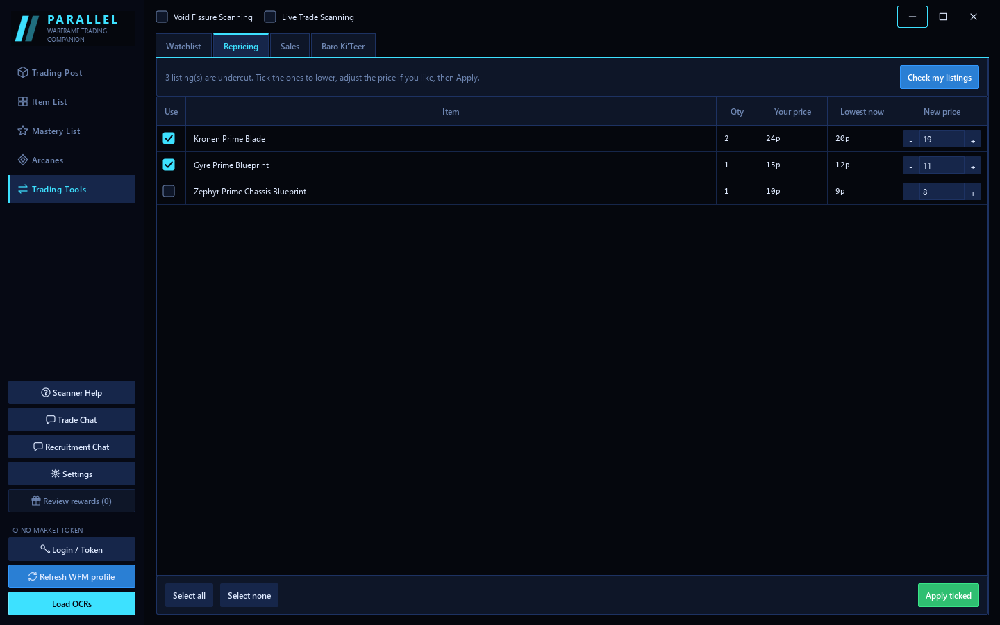
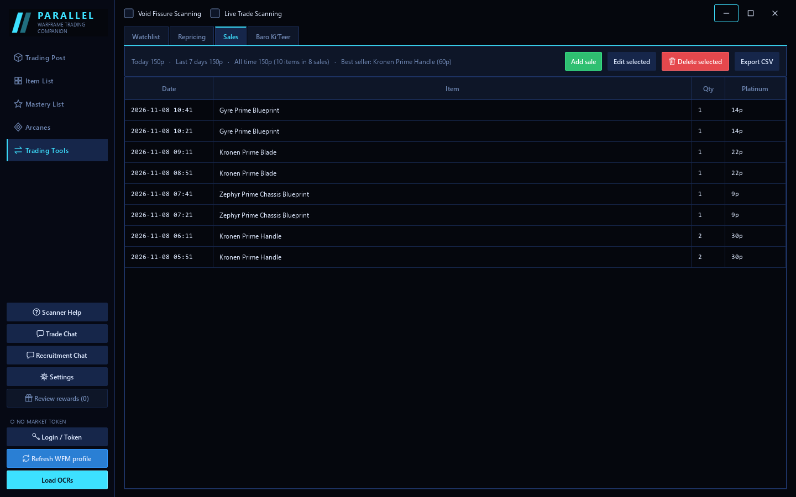
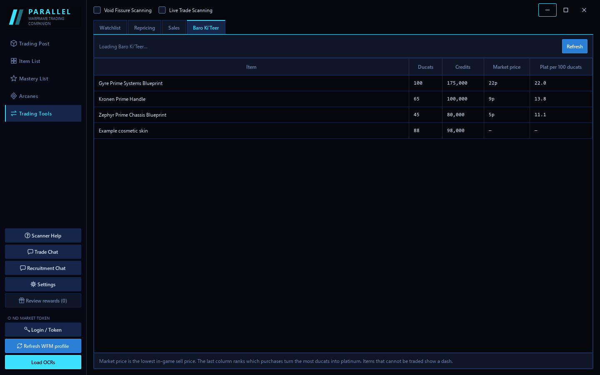
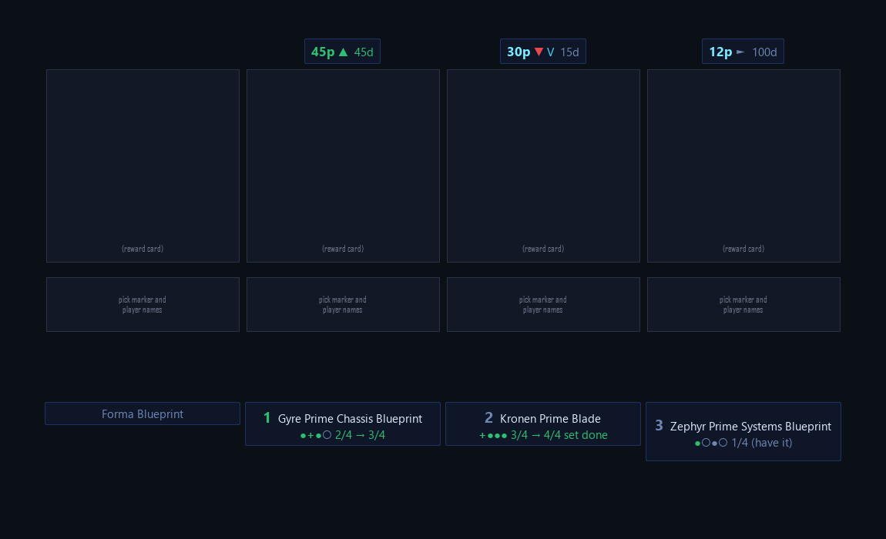

# Parallel

Parallel is a Warframe trading companion for Windows. It reads your screen to scan your inventory,
shows prices over Void Fissure rewards, helps you list items on warframe.market, and tracks sets,
mastery and arcanes. It never changes your listings by itself: every listing, update or delete is
shown to you first and only happens when you confirm it.

Parallel is a modified fork of [Sidro](https://github.com/Hitakumori/Sidro) by Hitakumori, used under
the MIT License. See [NOTICE.md](NOTICE.md) and [LICENSE](LICENSE). It is not affiliated with Digital
Extremes or warframe.market.

## How to install

1. Open the [latest release](https://github.com/Chukway/Parallel/releases/latest) and download
   **Parallel-Setup.exe**.
2. Run it. Windows may show a blue **"Windows protected your PC"** screen because the installer is not
   code-signed (signing certificates cost money and this is a free hobby project). Click
   **More info**, then **Run anyway**. You can check the source code in this repository.
3. Follow the installer. It installs for your Windows account only and does not need administrator
   rights. A desktop shortcut is optional.
4. Start **Parallel**. A short tour explains each part and can be skipped.
5. Click **Login / Token**, then **Get token automatically**, and sign in to warframe.market in the
   window that opens. Parallel picks up the token for you and the window closes by itself. Your
   password is never seen or saved, and nothing from that sign-in window is kept on disk.
6. Parallel asks for your exact Warframe in-game name. It uses the name to recognise your own trades.
   You can change it any time under **Settings**, then the **Account** tab.

Tips for good scans: keep Windows **HDR turned off** while scanning, and run Warframe in a window
or borderless mode so the screen can be captured.

To remove Parallel, use **Settings, Apps** in Windows. Your items and settings are kept in
`%LOCALAPPDATA%\Parallel` and stay after uninstalling; delete that folder yourself if you want
them gone.

## Hotkeys

These are the defaults and can be changed in **Settings**, then **Hotkeys**.

| Hotkey | What it does |
|---|---|
| Ctrl+Shift+I | Scan the visible 6x3 grid on Warframe's inventory sell screen |
| Ctrl+Shift+B | Scan the final visible row after scrolling to the bottom |
| Ctrl+Shift+A | Scan the visible arcanes on the ARCANES screen (each tile is read for name and rank, identical ones are counted; also works on the Inventory sell tab, where rank is not shown) |
| Ctrl+Shift+R | Show prices over the Void Fissure reward screen |
| Ctrl+Shift+T | Trade monitor: removes sold items from your listings after a trade completes |
| Ctrl+Shift+S | Look up a single item you select on screen |
| Ctrl+Shift+M | Open the local inventory and listing manager |
| Ctrl+Shift+O | Load or unload the screen-reading (OCR) engines |
| Ctrl+Shift+Q | Quit |

A small notification with a moving bar appears when a scan starts, so you know the hotkey worked.

## Finding your way around

The left side of the window has the pages (Trading Post, Item List, Mastery List, Arcanes,
Trading Tools). Below them are **Scanner Help**, **Trade Chat**, **Recruitment Chat**, **Settings**
and **Review rewards**. At the bottom, under the market status, are **Refresh WFM profile** and
**Load OCRs**. The two background scanners (**Void Fissure Scanning** and **Live Trade Scanning**)
are checkboxes along the top. The log viewer is in **Settings**.

*All screenshots below use made-up example data.*

## Item List

| Button | What it does |
|---|---|
| Refresh set data | Looks up how many parts each set needs (cached afterwards) |
| Select all / Deselect all | Selects every visible row, or clears the selection |
| Sell selected on warframe.market | Opens the review window with prices; nothing is listed until you confirm |
| Add set to Mastery List | Sends the selected item's set to the Mastery List |
| Combine set | Lists one full set from the selected item's parts, then lowers or deletes the listings of those parts so nothing is sold twice. You choose the price and confirm the exact changes first |
| Set vs parts | Compares each selected set's price with its parts added up |
| Add to watchlist | Sends the selected items to Trading Tools, Watchlist |
| Watch still-needed parts | Sends only the parts you are still missing to the Watchlist |
| Remove selected items | Asks whether the items were sold; if so they are added to Sales with the price you enter |
| Add item / Edit selected item | Add or fix an item by hand (double-clicking a row also edits it) |
| Check my listings | Marks which of your items are listed on warframe.market |

### Set vs parts

One line per selected set: the set price, the parts added up, which is better to sell and by how
much. Double-click a set to show or hide the price of each part. Prices are the lowest from players
who are in game.

### Combine set

Select one part of a set that you own in full and press **Combine set**. Parallel asks you to
confirm, opens the usual price review for the set, then shows exactly which part listings will
change before anything is sent. It lists the set (or adds one more to your existing set listing)
and then lowers or deletes the listings of the parts the set uses: parts that go into the set
completely lose their listing, extras stay listed. A part that needs two copies uses two. If the
set listing fails, your part listings are left alone. The parts stay on your Item List until they
sell, and then **Remove selected items** asks whether they were sold.

### Removing items you sold

When you remove items from the Item List, or delete a listing in the Trading Post, Parallel asks
whether they were sold. Tick what sold, say how many (for example 1 of 2) and the total platinum,
and the sale goes into the Sales log. If you sold only some, the rest stays on your Item List, and a
market listing is lowered by that many instead of deleted.
## Trading Tools

None of these changes your market listings without you ticking rows and confirming.

### Watchlist

Alerts when something you want to buy drops to your price (a buy wishlist), or when something you
hold reaches the price you want (a sell alert). It is checked every 10 minutes while Parallel is
open, and only when the list is not empty. An item alerts once, then stays quiet for 6 hours.

- **Update prices**: lowest sell, average of the 10 cheapest, top buy order, and a suggested buy
  price (1p over the best buy order, or 80% of the lowest sell).
- **Edit selected** (or double-click): change the type or target of an entry.
- **Post buy listing**: opens a review window, then creates a buy order on warframe.market, or
  changes the one you already have for that item. You can post it hidden.
- Items can also be sent here from the Item List and Mastery List.

### Repricing

**Check my listings** finds sell listings that a player in game is undercutting and suggests a new
price. Tick rows (or **Select all**), adjust the price if you like, then **Apply ticked**.

### Sales

Platinum today, over 7 days and overall, plus your best seller. **Add sale** records one by hand,
for example a trade the monitor missed (it can also take the item out of your Item List). Removing an item from the Item List, or deleting a listing in the Trading Post, asks whether it was sold and records the sale if you say yes. You can
edit or delete entries and **Export CSV**. Only sales recorded after this feature was added have a
price, and you can fill older ones in with **Edit selected**.

### Baro Ki'Teer

His current stock with market prices and a ducats-to-platinum ranking, from the community API
warframestat.us. Items that cannot be traded show a dash.

### Rewards

Every reward screen Parallel reads is saved here with its prices. If it missed which reward you
took, select that reward and press **Add to Item List**.
## Trackers

The **Trackers** group in the sidebar shows what is going on in the game without opening a browser.

- **Live**: Cetus, Orb Vallis, Cambion Drift, Earth and Duviri cycles, the current Arbitration with the next three, Baro, and normal and Steel Path Void Fissures side by side. Bounties, Darvo's deals, alerts, events, invasions, Railjack storms and Steel Path incursions are available but off by default.
- **Daily**: Sortie and a daily tick list.
- **Weekly**: Duviri Circuit rotation, Archon Hunt, the Steel Path reward and a weekly tick list. Tick boxes clear themselves at the reset (daily 00:00 UTC, weekly Monday 00:00 UTC).
- **Archimedea**: this week's Elite Temporal and Elite Deep Archimedea with their missions, debuffs and risks.
- **Arbitration**: the full hourly schedule with mission, tier and faction filters, local or UTC time. Schedule data is from [browse.wf](https://browse.wf/arbys) and the tier ratings are by the Arbitration Goons community; thank you to both.
- **News**: game news and Nightwave.

Data refreshes every two minutes and timers count down every second. If you are offline the pages keep
the last data, and the day/night cycles keep running. In **Settings, Trackers** you can turn every card
on or off, rename cards and pages, and choose notifications. With **Closing the window hides Parallel
in the system tray** on, the close button keeps Parallel (and its hotkeys) running in the tray; right-click
the tray icon to open or quit.

## Reward screen overlay

On a Void Fissure reward screen Parallel puts two small labels on each card. Both ignore the mouse,
and the lower one sits below the row where the game shows who picked what, so it never blocks the
pick reading.

- **Above the card:** the platinum price and the ducat value (`7p  45d`), with an arrow for the
  recent price direction (green up, red down, grey steady) and a gold **V** for vaulted parts. The
  recommended reward is shown in green.
- **Below the card:** a recommendation number (1 is best), the item name, and its set: one dot per
  part (`●` you own it, `○` you don't, a green **+** for the part this reward gives you), then what
  picking it does, for example `0/4 → 1/4`, `set done` when it completes the set, or `(have it)`.

Items with no market price, such as Forma, get no number. In **Settings, Alerts** you can rank by
platinum or by ducats, or switch to a single ranked list in the corner, or to the older tags.
### Reviewing queued rewards

**Review rewards** (left side) lists the rewards you picked, which are already on your Item List.
Tick **List** and press **Apply selected** to post them to warframe.market; if the item is already
listed, the new copies are added to that listing. To keep a reward on your Item List without listing
it, tick **Don't list** on it (or tick **List** on the rewards and press **Keep in Item List**, which
ticks them for you). **Don't list all** ticks every row. Rows marked Don't list are cleared from the
queue when you press **Apply selected**.
## Your data and backups

- Everything personal stays on your computer in `%LOCALAPPDATA%\Parallel`: your token, settings,
  items and sales log. Do not upload that folder anywhere.
- **Settings, Account** has **Back up everything** and **Restore everything from backup** for your
  items, sales, mastery list and arcane list. A backup leaves your token out unless you choose to
  include it. Parallel also makes an automatic backup about once a day and keeps the latest ten.
- Treat your token like a password. If you share a backup file, do not include the token.

## Notes

- Arcanes are tracked, priced and listed per rank. The ARCANES-screen scan reads each tile's rank
  from its diamonds; scanning only ever raises a count (to the larger of your stock and what is on
  screen), so overlapping screens are never counted twice. Remove sold copies on the Arcanes page.
- Parallel only captures the screen and talks to warframe.market over normal HTTPS. It does not
  inject into Warframe or read game memory.

## Building from source

See [build_parallel.md](build_parallel.md) for the PyInstaller build and `tools/Parallel.iss` for the
Inno Setup installer. [PUBLISHING.md](PUBLISHING.md) lists the checks that run before a commit.

## Updates

Parallel checks GitHub for a newer release in the background (Settings sets how often, and has a manual check).
Copies installed with `Parallel-Setup.exe` can download the new installer, verify its checksum and update in
place; your items, listings and settings stay in `%LOCALAPPDATA%\Parallel`. Other copies get a link to the release page.

## License

Parallel is a modified fork of [Sidro](https://github.com/Hitakumori/Sidro) by Hitakumori, used under the
[MIT License](LICENSE), which allows reuse, modification and commercial distribution while retaining its notice.
Third-party libraries, OCR models and game assets keep their own terms; see
[third-party notices](release_materials/THIRD_PARTY_NOTICES.md) and [NOTICE.md](NOTICE.md).

## Credits

Maintained by Chukway. Based on Sidro by Hitakumori.
